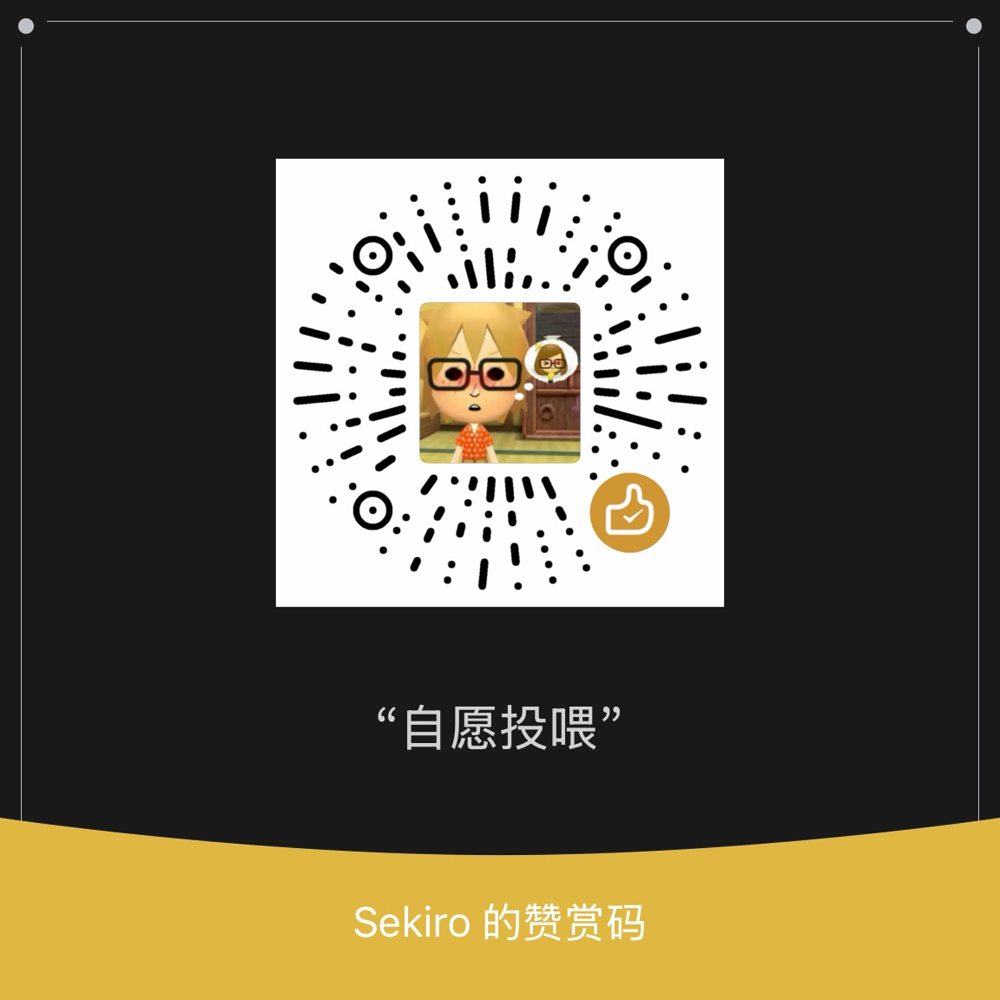

# BOSS直聘自动投递助手 — 发布包说明

## 包内容

```
BOSS_Release/
└── BossZhiPin_Job_Search/       ← 项目
    ├── setup.bat                ← Windows 一键安装脚本
    ├── main.py                  ← 入口
    ├── pyproject.toml           ← 依赖配置（uv 管理）
    ├── uv.lock                  ← 锁定的依赖版本
    ├── .env.example             ← 配置模板
    ├── README.md                ← 完整使用文档
    ├── src/boss_zhipin/         ← 核心代码
    │   ├── cli.py               → CLI 入口（搜索URL、关键词在这改）
    │   ├── website_oper/
    │   │   ├── finding_jobs.py  → 浏览器自动化
    │   │   └── write_response.py → 主循环（抓JD→LLM→发送）
    │   ├── models/
    │   │   ├── llm.py           → LLM 调用
    │   │   ├── prompts.py       → 招呼语 prompt
    │   │   └── job_matcher.py   → 简历-岗位匹配
    │   ├── vectorization.py     → 简历向量化
    │   └── audit/               → 招呼语校验+日志
    ├── tests/                   ← 单元测试
    ├── docs/wiki/               ← 技术文档
    └── scripts/                 ← 工具脚本
```


### 前置条件
- Python 3.11+
- uv 包管理器
- Chrome 浏览器
- 一个 LLM API Key（DeepSeek 推荐，便宜）

### 步骤

**1. 安装 Python + uv（一次性）**

```powershell
# Python: https://www.python.org/downloads/ (勾选 Add to PATH)
# uv:
powershell -c "irm https://astral.sh/uv/install.ps1 | iex"
```

**2. Clone + 安装依赖**

```powershell
git clone https://github.com/Seeeeekiro/Boss-Zhipin-Auto-Job-Application
cd BossZhiPin_Job_Search
uv sync
```

**3. 配置并运行**

```powershell
# 复制配置模板
cp .env.example .env

# 编辑 .env，填这 3 个：
#   LLM_API_KEY=sk-你的key
#   LLM_MODEL=deepseek-chat
#   LLM_BASE_URL=https://api.deepseek.com

# 放简历
# 把 PDF 简历放到 resume\my_cover.pdf

# 试跑（只生成不发送）
$env:DRY_RUN="1"
$env:PYTHONIOENCODING="utf-8"
uv run python -m boss_zhipin

# 正式跑
$env:PYTHONIOENCODING="utf-8"
uv run python -m boss_zhipin
```

##  关键配置位置（也可在env启动之后直接在网页上修改）

| 要改什么 | 在哪改 |
|----------|--------|
| 搜索城市 | `src/boss_zhipin/cli.py` 第46行 `city=101280600`（深圳） |
| 搜索关键词 | `src/boss_zhipin/cli.py` 第46行 `query=计算机` |
| API Key | `.env` 的 `LLM_API_KEY` |
| 求职类型 | `.env` 的 `BOSS_LABEL`（实习/校招/社招） |
| 黑名单 | `.env` 的 `BOSS_EXCLUDE_KEYWORDS` |(例如填写【博士】，则会不投递要求博士的岗位)
| 自定义招呼语风格 | `.env` 的 `BOSS_LETTER_PROMPT` |

##  各 LLM API Key 申请地址（推荐deepseek）

| 服务商 | 申请地址 | 填写方式 |
|--------|----------|----------|
| DeepSeek | https://platform.deepseek.com/api_keys | `LLM_BASE_URL=https://api.deepseek.com` |
| 通义千问 | https://bailian.console.aliyun.com/ | `LLM_BASE_URL=https://dashscope.aliyuncs.com/compatible-mode/v1` |
| 智谱GLM | https://open.bigmodel.cn/usercenter/apikeys | `LLM_BASE_URL=https://open.bigmodel.cn/api/paas/v4` |
| OpenAI | https://platform.openai.com/api-keys | 不填 `LLM_BASE_URL`（用默认） |
| Claude | https://console.anthropic.com/settings/keys | 需要中转或兼容代理 |

##  核心依赖

| 包 | 用途 |
|----|------|
| `nodriver` | Chrome CDP 浏览器自动化 |
| `openai` | 通用 LLM API 调用 |
| `chromadb` | 向量数据库（简历-岗位语义匹配） |
| `sentence-transformers` | 文本向量化模型 |
| `pypdf` | PDF 简历解析 |
| `python-dotenv` | .env 配置读取 |

## ⚠️ 注意事项

1. 首次运行需要**微信扫码登录** BOSS 直聘，之后 cookie 持久化在 `chrome_profile/`
2. 使用前建议先 `DRY_RUN=1` 试跑，检查生成的招呼语质量
3. 本项目仅供个人求职使用，使用浏览器自动化可能违反 BOSS 直聘服务条款
4. 不要在 `.env` 中提交 API Key 到公开仓库

## 感谢支持

如果这个项目帮到了你，感谢你的支持！


